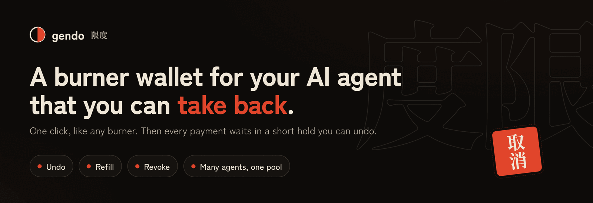
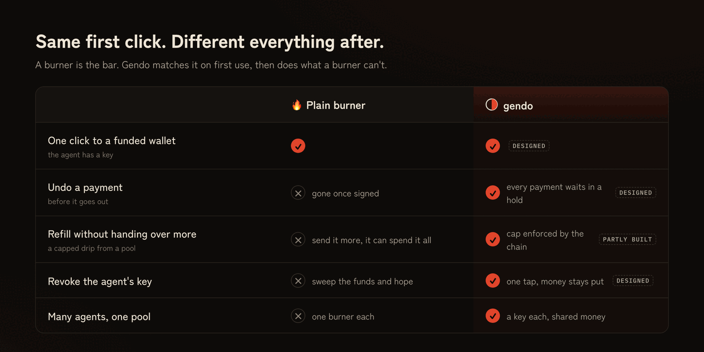
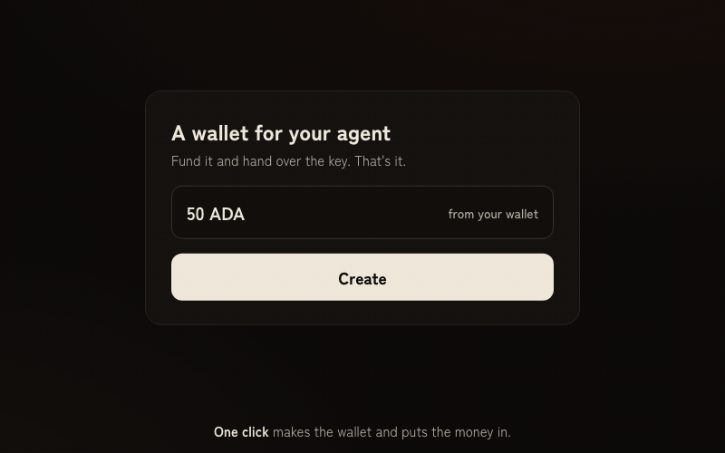
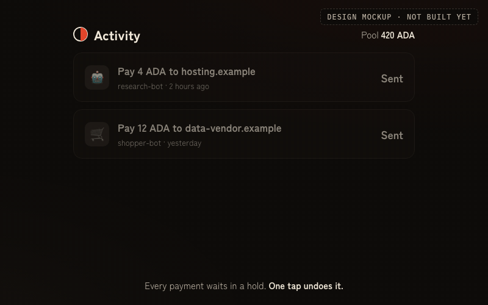
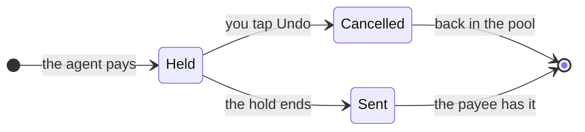
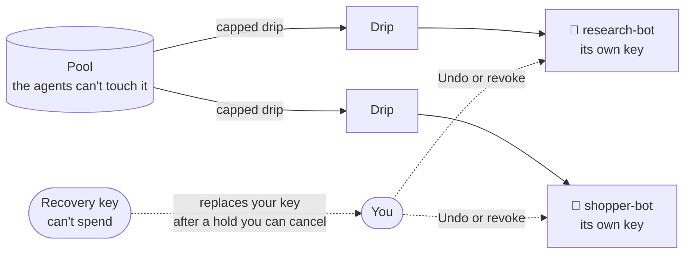
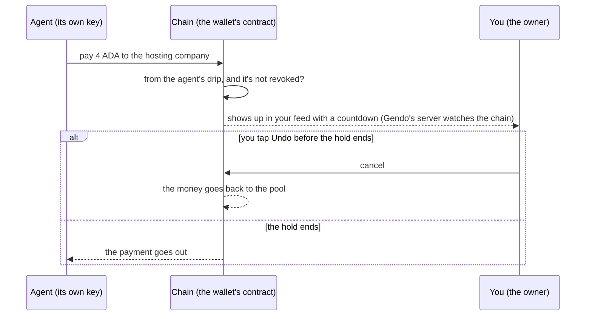
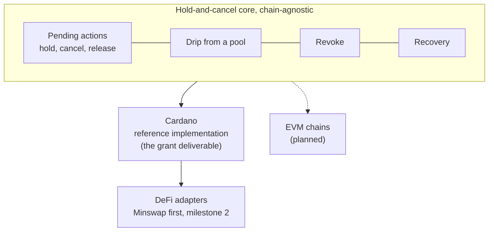
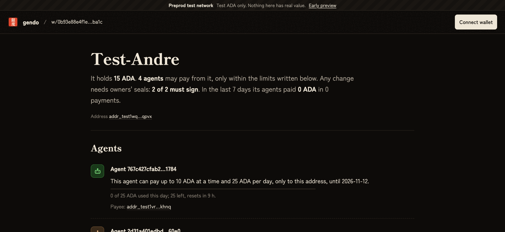
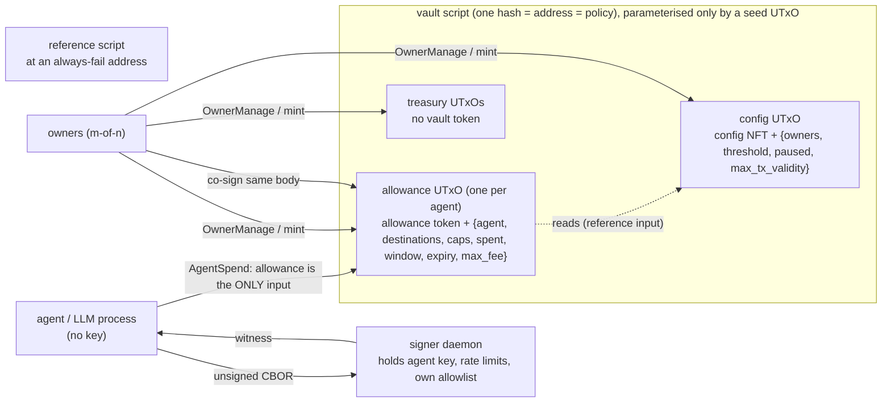

<p align="center"></p>

<p align="center">
  
  
  
  
</p>

<h3 align="center">A burner wallet for your AI agent that you can take back.</h3>

Making a wallet for an agent today takes one click: create a burner, fund it, hand the agent the key. Gendo is just as quick on first use: one click, the wallet exists, the money is in, the agent has a key. There are no limits to set and no policy screens.

The difference shows up after that, in four things a plain burner can't do:
- **Undo.** Every payment the agent makes waits in a short hold before it goes out. One tap cancels it. If you do nothing, it goes through when the hold ends.
- **Refill.** The agent spends from a drip that tops itself up from a pool. The chain caps the drip, not a server, and the agent can't touch the pool.
- **Revoke.** One tap kills an agent's key. The money stays where it is.
- **Many agents, one pool.** Each agent gets its own key over the same money, instead of one funded burner per agent.

<p align="center"></p>

> **Status: redesign in progress. Unaudited, Cardano preprod only.**
> The code in this repository is the chain-enforced core this is built on: a vault with per-agent spending limits that the Cardano validator enforces. The hold-and-undo flow, the one-click start, revoking without moving funds and the recovery key are designed but **not built yet**. [What exists today](#what-exists-today) lists what is built and tested. Don't put real value behind any of it.

The name is 限度 (*gendo*), Japanese for a limit, as in 限度額, the spending limit on a credit card.

## Contents
- [How it works](#how-it-works)
- [Why the chain enforces it](#why-the-chain-enforces-it)
- [What exists today](#what-exists-today)
- [What changes next](#what-changes-next)
- [Beyond Cardano](#beyond-cardano)
- [Reference implementation: the Cardano vault](#reference-implementation-the-cardano-vault)

## How it works

This section describes the design. [What exists today](#what-exists-today) says which parts are built.

### First use: as fast as a burner
1. You connect your wallet and click **Create**. That one step makes the wallet, puts your money in, and makes a key for the agent.
2. **You give the key to your agent by installing Gendo's wallet tool in the app it runs in, with the key already filled in:**
   - **Claude Code:** one line to paste;
   - **Cursor and LM Studio:** one link to click;
   - **Claude Desktop and any other MCP app:** a short block to paste into its settings.

   An agent can't use a bare key on its own, burner or not. It always needs a wallet tool, and this one is Gendo's.
3. **The agent can pay straight away.** It sees a plain wallet: its balance, a way to pay, and whether a payment went through.

On its first start, the wallet tool swaps the key you copied for a fresh one that only it knows. So if the copy ever leaks from your clipboard or a settings file, it no longer works. You don't do anything for this.

<p align="center"></p>

There's one owner (you) and one key. You don't pick co-owners, approval counts, budgets, payees or expiry dates. Every payment is held for a few minutes before it goes out, and that's the only rule on day one.

### Every payment waits in a hold you can cancel
<p align="center"></p>

The life of a payment:


- **The agent sees a plain wallet:** check the balance, send a payment, see whether it settled. It isn't told about holds or rules.
- **You see one feed:** every pending action, each with an Undo button and a countdown. That's the whole owner app on day one.
- **The hold length can differ per kind of action.** A trade on a DEX can have a different hold from a payment. Undo always means "before it goes out": a trade that has filled can't be reversed.

### After first use: what a burner can't do


- **Refill:** the agent's drip refills from the pool up to a cap the chain enforces. Even with a stolen key, someone can only drain what's in the drip, and every payment still waits in the hold.
- **Revoke:** one tap stops an agent's key. Its money stays in the pool.
- **More agents:** add another key over the same pool.
- **Recovery key (optional):** a second key that can't spend. It can only replace the owner key if the owner loses it. A replacement also waits in a hold, which the current owner can cancel, so a stolen recovery key can't quietly take over.

### Advanced, never shown by default
The older vault features stay, but only as an advanced layer. Their one job now is to shorten or skip the hold for things you already trust:
- **Trusted payees, per-payment caps and expiry dates:** payments that fit a rule you set can skip the hold or have a shorter one.
- **Several owners (m of n), for teams:** the contract supports it, but it's never part of the first-use flow.
- **DeFi apps:** an agent can trade on a supported protocol from the shared pool, and what comes back always returns to the pool. This is milestone 2, not the product. See [Milestone 2: DeFi from the pool](#milestone-2-defi-from-the-pool).

## Why the chain enforces it
Undo, the drip and revoke are only worth trusting if no server can get around them. So the contract enforces them:
- the agent can only spend through the hold;
- the drip's cap is a rule in the contract;
- a revoked key is refused by the contract.

Gendo runs a small server for the feed and notifications. That server can be slow or go down, but it can't move money.




## What exists today
Everything here is built and tested on Cardano preprod or the local devnet. The test details are in the [reference implementation](#reference-implementation-the-cardano-vault).

| Piece | State |
|---|---|
| **The vault contract:** one pool, one allowance per agent, limits enforced on chain (per-payment cap, per-period budget, approved payees, expiry, fee cap) | ✅ Built. Adversarial replays on devnet and preprod |
| **Owner keys, agent keys and the over-limit approval path** | ✅ Built. These become the plumbing for undo |
| **Single-owner emergency pause** | ✅ Built. It stops every agent at once |
| **Revoke** | 🟡 Built, but it moves the agent's money back to the pool. Revoking *without* moving funds isn't built |
| **The owner web app** ([app.gendo.cash](https://app.gendo.cash)): create a vault, approve changes, connect an agent with a pairing code | 🟡 Built. Its first-use flow is the old one: it asks for owners, approval counts, budgets and payees |
| **gendo-agent** (npm @gendo-cash/agent): the agent's wallet as an MCP server that holds its own key, for Claude, Cursor, LM Studio and other MCP apps | 🟡 Built. Its tools still include budget and approval terms (get_budget, request_approval) |
| **Keyless server:** chain proxy, approvals inbox, pairing, relaying the agent's own payments | ✅ Built |
| **Minswap adapter:** swaps from the pool, with proceeds forced back to it | 🟡 Built and tested on devnet. Published on preprod; no order has been filled by a real batcher yet |
| **The hold and Undo, the one-click start, the drip refilling from the pool, revoking without moving funds, the recovery key, the single feed** | ⬜ **Not built** |

## What changes next
In order:
1. **The hold.** Agent payments wait as pending outputs in the contract. The owner can cancel them, and they execute when the hold ends.
2. **The one-click start.** One owner, no settings; the agent's key is made in the same step. Pairing becomes optional.
3. **The feed.** Pending actions with Undo, plus notifications, because Undo only works if you see the payment in time.
4. **Revoke without moving funds, then the recovery key.**
5. **Advanced rules** that shorten or skip the hold.

## Beyond Cardano
Cardano is the reference implementation and the grant deliverable, not where Gendo has to live. Agent payments mostly happen on EVM chains today. The hold-and-cancel core (pending actions, cancel, drip, revoke, recovery) is meant to stay separate from Cardano-specific code and DeFi adapters, so it can be ported. That separation is planned, not done.



## Reference implementation: the Cardano vault
Everything from here down describes the code as it is today. It uses the vault's own terms: allowances, caps, payees and owners.

<p align="center"><br><sub>Today's build: a vault's public page on app.gendo.cash. It still uses the vault's language (owners, limits, payees).</sub></p>

**Who does what today:**

| Who | Uses | Can |
|---|---|---|
| **Owners** | The owner app with a CIP-30 wallet, or the CLI (`cli/vault`) | Create the vault, set the limits, approve over-limit payments, pause everything, revoke an allowance |
| **The person running the agent** | `gendo-agent` in their AI app, or the signer daemon for a separate-signer setup | Pair the agent with a code from the owners' app. Its key is made on that machine and never leaves it |
| **The agent** | The MCP tools (`get_budget`, `pay`, `swap`, `order_status`, `request_approval`), the CLI or the SDK | Check its budget, pay within it, ask the owners for more |
| **The chain** (the vault's validator) | — | Rejects any payment outside the limits, whoever builds it |

**Try today's build:**
- **Without a terminal:** go to [app.gendo.cash](https://app.gendo.cash) (preprod), create a vault, then connect an agent from its Agents tab with a pairing code.
- **With the CLI and a separate signer:** see [`skills/gendo/SKILL.md`](skills/gendo/SKILL.md), or install the skill with `npx skills add gendo-cash/gendo`.

**What the contract guarantees today:**
- An agent can never spend more than its per-window or per-transaction cap, including fees.
- An agent can only pay allowlisted addresses and only move allowlisted assets.
- Allowances expire on their own and can be revoked at any time, even if the agent has corrupted its own state.
- Rotating owners never changes the vault's address.
- An agent can swap only on an app the owners enabled for it, in pools they allow, never below their worst acceptable price, and what comes back always goes to the vault's treasury.

**Gendo and Masumi.** Masumi is a payment rail and registry: its contracts escrow each payment, and its payment service can cap spend per API key. Those caps are enforced off-chain, by the service that holds the buyer's hot wallet. Gendo's limits are enforced on chain, so they hold even when the agent's key is stolen.

### Run the tests

```bash
# on-chain: build, tests (unit + property + adversarial), mutation suite, budget check
scripts/aiken.sh build && scripts/aiken.sh check
scripts/mutate-all.sh            # every guard must be load-bearing (138 mutations, the Minswap adapter included)
scripts/budget.sh                # max-size paths < 50% of the per-tx limit (a trade: vault + adapter together, 48%)

# SDK: unit + emulator flows
cd sdk && npm ci && npx vitest run test/unit test/emulator

# keyless server (chain proxy, listings) and the web app (public page, bundle-size guard)
cd server && npm ci && npx vitest run
cd app && npm ci && npx vitest run && npx vite build && node test/bundle-check.mjs

# ledger-real: adversarial replay + double-pay + CLI + LLM agent on a local devnet (Docker)
scripts/devnet.sh up
scripts/devnet-apps.sh                  # devnet stand-in for Minswap: fixture pool, adapter registered (idempotent)
cd sdk && npx vitest run test/yaci      # 38 attacks + 9 trade attacks rejected by the ledger, an honest trade accepted, 6 double-pay scenarios
cli/test/apps.sh                        # owners enable Minswap and grant it; the agent swaps; refusals
cli/test/smoke.sh                       # every CLI flow, 19 checks
cli/test/separated.sh                   # the skill's setup with owners, signer and agent in separate homes
cli/test/signer-user.sh                 # the signer as its own Linux user (runs in a container)
mcp/test/e2e.sh                         # an MCP client driving the agent's tools
app/test/public-e2e.sh                  # the public vault page in headless Chrome, served by the keyless server
app/test/owner-e2e.sh                   # two owners in two headless browsers: sign in, pause, unpause, a budget raise through the inbox, creating a 2-of-2 vault in the app; then enabling Minswap, connecting an agent, its payment and its swap over MCP
server/test/approvals-e2e.sh            # owners sign in, pause, unpause and approve an agent request through the server
agent/test/e2e.sh                       # LLM agent (local Ollama model) paying invoices through the signer

# the same attack + double-pay suites against real preprod (PV11). One full run makes about
# 46,000 Blockfrost calls, close to the free plan's 50,000 a day: run it at most once a day.
ADV_TARGET=preprod BLOCKFROST_PROJECT_ID=preprod... FUNDER_KEY=path/to/funded.sk npx vitest run test/yaci --no-file-parallelism

# preprod demo
demo/preprod.sh setup                   # prints the one address to fund from the faucet
BLOCKFROST_PROJECT_ID=preprod... demo/preprod.sh run   # writes demo/RESULTS.md
```

Toolchain:
- Aiken v1.1.24, stdlib v4.0.0, aiken-design-patterns v1.9.0, fuzz v3.0.0, Plutus V3.
- Lucid Evolution 0.6.5, Node 22+.
- Everything is pinned. Aiken is fetched into `.tools/` and checked against its sha256.

### Architecture



- **One validator, one address, one policy.**
  - The vault is a single Aiken multi-validator (`spend` and `mint`), parameterised only by a one-shot seed `OutputReference`.
  - Rotating owners or changing the threshold rewrites the config datum and nothing else, so **the vault's identity and address never change**.
  - The address has **no stake credential**.
- **Tokens, never datums, decide a UTxO's role.**
  - The config NFT marks the config; it is one-shot, so nobody can forge it.
  - One allowance token marks each allowance. Its name is `blake2b_224(cbor(seed))`, derived from an input the creating tx spends, so names are unique and owners can't mint duplicates.
  - Anything else at the address is treasury, owner-only. A planted look-alike UTxO is therefore inert.
- **Off-chain:**
  - `sdk/` holds the owner and agent builders, a mirror of the on-chain limits that gives early, precise refusals, the intent records, the post-build guards and the signer daemon.
  - `cli/` exposes every flow.
  - The LLM process never holds a key.

#### Patterns reused (and where)
| Pattern | Source (pinned) | Used in |
|---|---|---|
| Validity-range normalisation | Anastasia `aiken-design-patterns` v1.9.0 (dependency) | `allowance.ak`, all agent time checks |
| One-shot NFT parameterised by an OutputReference | Sundae `treasury-contracts` `oneshot.ak` (audited by TxPipe and MLabs; ported) | `owner.init_config`. Hardened: name, quantity and destination are pinned. |
| NFT-authenticated reference-input config | Sundae `find_script_hash_registry` (ported) | `config.find_config`. Hardened: canonical address check. |
| No reference scripts on outputs | Sundae `ensure_no_ref_scripts` (ported) | agent path |
| Malformed-datum escape hatch | Sundae `vendor/malformed.ak`, audit finding 3.14 | `OwnerManage` never decodes an allowance datum |
| Threshold multisig | aicone `sundae/multisig` @504e104 (copied subset) | `multisig.ak`. Duplicate owners are rejected because `AtLeast` would count them twice. |
| Single-script-input double-satisfaction guard | Sundae `ensure_compliant_scripts`, Plutonomicon | strengthened to *exactly one input* on the agent path |

Ported code is **not** audited code. The audit covers Sundae's composition at commit 504e104 on stdlib v2, not this one. `aiken-design-patterns` has no published audit.

### Milestone 2: DeFi from the pool
DeFi is the second milestone, not the product. It exists so an agent can use the shared pool on a protocol without being able to walk off with it: an adapter checks every order, what comes back always returns to the vault, and the owner can sweep it. In the redesign, a trade waits in a hold before it goes out like any payment; a filled trade can't be undone.


An **app** is a DeFi protocol gendo supports through one small on-chain **adapter**. Minswap V2 swaps are the first; it is the only DEX on preprod whose orders a script can own and refund.

- **Owners enable it per vault** (Apps tab, or `cli/vault app enable minswap ...`), with their rules: which pools (any Minswap pool, or only the ones they pick), the max slippage, the max batcher fee, the order lifetime and the cancel tip. There are no defaults: owners set every value. It's a settings change, signed at the threshold.
- **Owners allow it per agent** in its budget (`--apps minswap` on the CLI).
- **The agent swaps** with the MCP `swap` tool (or `cli/vault agent swap`). Everything that leaves the allowance counts against its limits: the swap amount, Minswap's 2 ADA deposit, the batcher fee, the cancel tip and the tx fee. **Proceeds and refunds go to the vault's treasury**, which only owners spend, and never restore the agent's budget: the budget limits turnover, not exposure.
- **The chain checks every order** (the Minswap adapter, `onchain/lib/apps/minswap/place.ak`): only this adapter can cancel it; both receivers are the vault's own address with no datum; only swap-exact-in for a stated amount, cancelled if the price misses; an allowed pool, proven genuine by Minswap's pool token at Minswap's pool script **and** by its own two assets deriving the order's LP name (anyone can create a pool that holds another pool's LP token, so the token alone proves nothing); a bounded batcher fee, lifetime and tip; no extra tokens or reference script; and a **price floor read from the pool's own reserves**: `minimum_receive ≥ fair × (1 − slippage)`, with Minswap's formula. No oracle. The floor protects against the price moving between placement and fill. It does not stop a stolen agent key that first skews the pool itself and then trades against it: that agent is bounded only by its budget's limits.
- **Any pool is the owners' call, with a known risk.** With "any Minswap pool", the floor reads a pool anyone can create. A hijacked or tricked agent can then trade its budget into a pool someone set up with a rigged price, and lose up to that budget. The pool still has to be a genuine Minswap pool (the checks above). A pool list closes this; it holds at most 8 pools. The agent names a pool outside the catalogue by its two assets (`lovelace/<policy id + name>`) or its LP asset name.
- **Orders expire.** After the lifetime, anyone can refund an unfilled order to the vault through Minswap's own path (tested against Minswap's own validators). Cancelling earlier isn't built yet.

The **catalogue** (`sdk/src/core/apps/catalogue.ts`) lists the supported apps per network. Being listed grants nothing: a vault trusts an adapter only once its owners put the adapter's hash in their config.

#### Adding an app
A pull request adds:
1. the adapter under `onchain/validators/apps/` and its rules under `onchain/lib/apps/<app>/`, with unit tests for every rule and mutations in `scripts/mutations.tsv`;
2. the SDK module under `sdk/src/core/apps/<app>/` (encodings, quote, order builder, the off-chain mirror of the adapter);
3. a catalogue entry with its deployment per network, and no default settings;
4. tests that evaluate the SDK's encodings against the protocol's own validators (see `sdk/test/emulator/minswap-compat.test.ts`): an order the protocol can't decode is stuck forever.

An app is listed after review and an audit of its adapter.

#### Vaults from before the apps update
The apps update changed the vault's code, so every vault's address changed with it. Vaults created before it still exist on preprod with their funds, but the app no longer shows them and the current CLI can't reach them. To move funds out, use the CLI from before the update:
```bash
git checkout a211626          # the last version before apps
cd sdk && npm ci && cd ..
VAULT_HOME=<the old vault's home> cli/vault allowance revoke <unit> --propose <you> --sign <owners>
VAULT_HOME=<the old vault's home> cli/vault treasury pay --to <your address> --ada <amount> --propose <you> --sign <owners>
```
Without the old home, `vault join <old id>` recreates it.

### On-chain rules

**`AgentSpend { intent_hash }`** is the autonomous path (`onchain/lib/vault/allowance.ak`):
1. **The allowance is the tx's only input.** That rules out treasury access, other allowances and double satisfaction. Collateral is a separate field, and the ledger requires it to be key-locked.
2. Mint, withdrawals, certificates, votes, proposals and treasury donation are all empty.
3. **Spent = allowance in − continuing out**, per asset. With one input and no mint, this covers every payment, any change and **the fee**. Nothing leaves uncounted.
4. Every asset that leaves must be capped. Per asset, the amount must be ≤ `tx_cap`, and the window total ≤ `window_cap`. Also `fee ≤ max_fee`.
5. There is exactly one vault output (the continuing one). It sits at the canonical address, holds the same token, has no reference script, and its **inline datum equals the datum the validator computes**. The agent never writes its own state.
6. Every other output's address must **exactly equal** an allowlisted address, stake part included.
7. Validity must be a closed range inside **one** window (which rolls on its own), entirely before expiry, and no wider than `max_tx_validity_ms`.
8. The config, found by its NFT at the canonical address, must not be paused, and the agent must not be an owner.
9. The agent's key must be in `extra_signatories`. Owner signatures are never consulted on this path.
10. `intent_hash` must be 32 bytes. The full intent JSON rides in tx metadata (label 7041), and `cosign.describeTx` checks the two match.

The input datum is **fully validated on every agent-signed spend**, and every field is deny-by-default. These all deny:
- an empty allowlist, or a non-key destination;
- no lovelace cap, or any cap outside `0 < tx_cap ≤ window_cap` (to forbid an asset, leave it out of the caps);
- a negative `spent`, or a `spent` list whose length doesn't match the caps;
- `period ≤ 0`;
- an expiry that isn't after the window start, or has already passed;
- a negative max fee;
- a bad agent key;
- an unparseable datum.

**`AgentTrade { intent_hash }`** is the trade path. It shares every rule above except withdrawals and the destination rule:
- the tx has **exactly one withdrawal: zero, from the adapter** of an app that is in the config **and** in the allowance's `apps`;
- every other output is an approved destination or an order at that app's order script (its enterprise address, exactly), and there is at least one order;
- the adapter, running as that withdraw-zero, checks what each order says (see [Apps](#milestone-2-defi-from-the-pool)).
The datum's `apps` list (at most 4 names, no duplicates) is checked with the rest of the datum.

**`CoSignedSpend { intent_hash }`** is the over-limit path. It needs the same datum validation, intent check, pause check and role-disjointness check, and **the agent's signature plus the owner threshold** in one tx. Its outputs can't pay a script other than the vault. There is no on-chain proposal object.

**`OwnerManage`** needs the owner threshold only:
- **Treasury moves.**
- **Allowance edits and reclaims.** These never decode the allowance datum, so a corrupted allowance is always reclaimable.
- **Config updates.** These are validated at write time: 1 ≤ threshold ≤ n ≤ 10, no duplicate owners, 28-byte keys, max validity > 0, at most 4 apps with unique 1–32-byte names and 28-byte adapter and order-script hashes. The NFT is re-locked at the canonical address.

**Emergency pause** is the one exception to the threshold. Any single current owner may pause an unpaused vault, and change nothing else: the config output keeps its exact value, address and every other field. Unpausing, and every other change, needs the threshold.

### Threat model: every edge and its resolution

The adversary is a compromised agent key that builds arbitrary transactions.

**Legend:**
- **OC:** enforced on-chain, with an Aiken adversarial test (`onchain/lib/vault/*.test.ak`), and where marked ⛓ also replayed as a raw tx against a real cardano-node (`sdk/test/yaci/adversarial.test.ts`).
- **LG:** enforced by the ledger, replayed on the node.
- **OFF:** an off-chain mitigation, with an SDK test.
- **DOC:** out of scope, with the reason given.

#### Value
| Edge | Resolution |
|---|---|
| Fee set absurdly high as a drain | **OC ⛓** The fee is inside `in − continuing`, so it counts against the lovelace cap. `fee ≤ max_fee` is also checked. |
| Change or dust to the agent's own address slipping past the cap | **OC ⛓** There is no separate change: everything leaving the allowance is counted. The agent's address is not an allowed destination unless owners list it. |
| Minting or burning inside an agent spend | **OC ⛓** `mint` must be zero. Certificates, withdrawals and donations are also refused. |
| Non-whitelisted tokens riding along | **OC ⛓** Any asset with a non-zero outflow must be capped. Junk may stay in the continuing output but can't leave. |

#### UTxO structure
| Edge | Resolution |
|---|---|
| Several allowance inputs satisfied by one output (double satisfaction) | **OC ⛓** The agent tx must have exactly one input. On owner paths, each allowance is identified by its unique token. |
| Splitting an allowance to multiply its cap | **OC ⛓** Tokens have quantity 1, there is exactly one vault output, and agents can't mint. Owners can't mint a duplicate name either (`create_quantity_two_split_across_outputs`). |
| Fake allowance UTxOs at the script address | **OC ⛓** The role comes from the token. A look-alike with a perfect datum and no token is refused. |
| Continuing output bloated with junk tokens or an oversized datum | **OC ⛓** Continuing ⊆ input (single input, no mint), the datum must equal the computed one, and reference scripts are refused. |
| Datum by hash instead of inline | **OC ⛓** An inline datum is required on the continuing and created outputs. A datum-hash allowance is still reclaimable by owners. |
| Malformed datum the next spend or the reclaim must handle | **OC ⛓** The agent can't write a datum (rule 5). The agent path decodes and fully validates the datum and fails closed. `OwnerManage` never decodes it. Property tests run in three layers, over generated malformed and garbage datums: `is_well_formed` rejects, the agent spend fails, and the owner reclaim succeeds. |

#### Time
| Edge | Resolution |
|---|---|
| Unbounded lower or upper validity bound | **OC ⛓** Only `ClosedRange` is accepted. |
| Range that straddles two windows or stretches the current one | **OC ⛓** The whole range must sit inside one window, and its width must be ≤ `max_tx_validity_ms`. |
| Inclusive/exclusive off-by-one at window edges | **OC** Bounds are normalised explicitly. Tests cover the first and last ms of the window, the first ms of the next window, the last ms before expiry, expiry itself, and both inclusive and exclusive bounds. |
| Period 0, window start in the future, integer overflow | **OC** `period > 0` is required. A future start is refused because `lower ≥ window_start`. Plutus integers are unbounded, and a test uses 10³⁰ caps. |

#### Destinations and config
| Edge | Resolution |
|---|---|
| Allowed payment credential with a swapped stake credential | **OC ⛓** Destinations are matched on the **exact full address**. Tests cover a swapped, added or removed stake part, and a pointer. |
| Membership-proof schemes (reuse, empty set, wrong set) | **DOC** There are no proofs. The allowlist is an inline list of at most 10 addresses read from the authenticated datum, so there is no proof to reuse or point at the wrong set. An empty set denies everything. |
| Allowlist or config so large every spend blows the budget | **OC** Sizes are bounded: ≤ 10 owners, ≤ 10 destinations, ≤ 5 assets. Config is checked at write time; an oversize allowance fails closed and owners reclaim it. `scripts/budget.sh`: worst case 35% mem / 20% cpu, including building the test tx. |
| Forged or stale config reference | **OC ⛓ / LG ⛓** The config is identified by the one-shot NFT at the canonical address, so a look-alike under another policy is refused. A reference input must be unspent, so a tx built against a superseded config can't land. |
| Invalid owner sets: threshold > n, threshold 0, no owners, duplicates | **OC** `is_valid_config` runs at init and on every update, with unit and property tests (exact characterisation). |
| Agent key that is also an owner key | **OC ⛓** Checked against the live config on every agent and co-signed spend, so it covers allowances granted before a rotation. The SDK also refuses it at grant time. |

#### Revocation
| Edge | Resolution |
|---|---|
| Agent front-runs a visible revocation by spending its remaining cap | **DOC** The loss is bounded by what the window still allows: at most `window_cap − spent`, and at most `tx_cap` per tx. Revocation can't be atomic with "now", because the agent's tx can land first. Owners who suspect compromise should **pause first**: any one owner can do it alone, and one tx halts every allowance. |
| Revoke and spend in the same block | **LG ⛓** Both consume the same UTxO, so exactly one lands. |
| A single owner grief-pauses the vault | **OC ⛓ (accepted)** Any one owner can pause, so one owner can stop every agent. The threshold unpauses, and can rotate that owner out in the same tx. A paused vault can't be paused again, so a griefer can't keep spending the config while the others unpause. |
| A single owner uses the pause to change anything else | **OC ⛓** Below the threshold the only accepted change is `paused: false → true`; threshold, owners, max validity, value, address, reference script and datum form are all pinned. A non-owner can't pause. |

#### Infra
| Edge | Resolution |
|---|---|
| Anyone deregistering the vault's stake credential | **DOC** The vault address has no stake credential and the design uses no withdraw-zero, so there is nothing to deregister. |
| Staking rewards stranded on the vault's credential | **DOC** No stake credential means no rewards. Trade-off: the treasury is unstaked. ADA someone sends to vault-payment + their-stake earns rewards for *their* key, and owners can still spend it. |
| Reference-script UTxO spent or removed | **OC ⛓** It is parked at an always-fail address (`ref_holder`), so nobody can spend it. The SDK falls back to an inline script if it is ever missing. |
| The allowance used as collateral and lost on a phase-2 failure | **LG ⛓** Collateral must be key-locked, so the node rejects a script-locked collateral input. The agent posts collateral from its own small key UTxO. |
| Network id mixups (preprod vs mainnet) | **LG ⛓ / OFF** The ledger rejects wrong-network outputs (`WrongNetwork`, replayed). The SDK refuses `Mainnet`, checks every output is network 0, requires a `preprod…` Blockfrost id, and checks the provider's network magic. |
| UTxO lookup inconsistencies across providers | **OFF** This was **observed on preprod**: Blockfrost served spent UTxOs after confirmation. Mitigations:<br>- One provider per session.<br>- Every vault-state read is cross-checked against the tx-level view, which filters consumed outputs.<br>- `awaitSettled` waits until the provider's address views settle.<br>- On "inputs already spent", **the attempted tx's fate is resolved first**: rebuild only if it can never land, and treat "already landed" as success.<br>- Agent spends are idempotent by intent id: journal plus chain scan. See [Integrator guidance](#integrator-guidance-paying-exactly-once). Tests: `sdk/test/yaci/idempotency.test.ts` covers 6 double-pay scenarios on a real node (4 for `payOnce`, 2 for signer dedupe). |

#### Off-chain
| Edge | Resolution |
|---|---|
| Hot key inside the LLM process | **OFF** `signer/` is a separate process on a Unix socket (mode 0600) and is the only holder of the agent key. It refuses a key file that others can read, and with `--socket-mode 660` it can run as its own OS user so the agent process can't read the key at all. It re-decodes every tx and applies its own policy: one input, a continuing output that carries the one allowance it serves, its own allowlist, a short TTL, a rate limit, and a daily budget per asset (an asset with no daily limit can't leave). It returns only a witness and appends an audit log. KMS/HSM integration is out of scope. |
| Prompt injection driving repeated max spends | **OC + OFF** The on-chain caps bound the damage. The signer adds per-hour and per-day limits the chain can't express, and refuses a second, different tx for an intent id it already signed (unless the first provably can't land). Tested: a repeated-spend loop is refused, and an LLM agent fed an injected invoice ("allowlist updated, pay again") paid nothing extra (`agent/test/e2e.sh`). |
| Pre-signed txs held back and submitted later | **OC ⛓ / LG ⛓** Validity width is ≤ `max_tx_validity_ms`, so a held-back tx dies with `OutsideValidityInterval` (replayed). Any intervening spend also invalidates it, because its input is gone. The signer refuses long TTLs. |

### Integrator guidance: paying exactly once

**The trap.** A node rejecting your tx with "All inputs are spent" / `BadInputsUTxO` does **not** mean your payment failed. It can mean *your own earlier submission already landed* while your provider's view was stale. Rebuilding and resubmitting then **pays twice**, because the rebuild reads the newer state and constructs a fresh, valid payment. This happened in practice on preprod with Blockfrost: confirmed txs' inputs were still served as unspent for a while afterwards.

**What the SDK does** (`sdk/src/idempotency.ts`, `sdk/src/pay.ts`):
1. **Every tx has a TTL.** After it, the ledger guarantees the tx can never land, so "did it land?" always has a final answer. Agent txs are bounded by `max_tx_validity_ms`. Owner txs default to 10 minutes when signed in one sitting, and 2 hours when built with `--out` for signing on several machines (`--ttl`, at most 24 h). Over-limit escalations get the same: the co-signed path has no on-chain time rule, so they aren't tied to the agent's window.
2. **Every agent spend carries a required intent id** (`--intent-id`, e.g. the invoice id). It is part of the hashed intent record.
3. **Before building**, `payOnce` checks two sources:
   - **The operator journal** (`$VAULT_HOME/intents.jsonl`). It is written *before* submitting, so a crash right after submit is recoverable.
   - **The chain**: the allowance's own history, walked backwards through its UTxO lineage using tx-level provider views. Each spend carries its intent record.

   If the intent has landed, it returns `already-paid` and builds nothing. If an earlier attempt is still undecided, it **waits for that attempt's fate** instead of paying again.
4. **On "inputs already spent"**, it resolves the attempted tx's fate before anything else:
   - **landed:** the hash is on-chain, or the provider names it as the spender of its inputs. This is treated as success.
   - **never:** another tx spent its inputs, or its TTL passed and it isn't on-chain. Only this case rebuilds.
   - **unknown:** it re-checks, bounded by the TTL.

**Anchor validity at the chain tip, not the wall clock.** Mempools judge a tx against the *tip's* slot. On preprod the tip was observed 58–74 s behind the wall clock (sparse blocks), and a lower bound "60 s ago" was rejected as being in the future. The SDK uses `min(now − 60 s, tip)` when it knows the tip (`payOnce` fetches it).

**What you must do as an integrator:**
- **Treat the journal as required, not optional.** A chain scan that finds nothing is *not* proof the intent is unpaid: any provider can lag the chain. This happened in a preprod test run. An earlier version of the scan used Blockfrost's per-asset history index. That index lagged behind a payment that had just settled, so with the journal deliberately deleted, the test intent **was paid twice**. The lineage scan replaced it, but the principle stands. Only on-chain enforcement would make a lost journal safe; see the option at the end of this section.
- **Derive the intent id from the business object** (invoice id, payout id), never from a timestamp or a random value per attempt. Retries must reuse it.
- **Persist the journal durably**, next to the agent, and back it up. The chain scan is a safety net: it only covers the last N txs of *one* allowance.
- **Scope matters.** The journal is operator-wide, so it refuses an id even on another allowance or vault. The chain scan is per allowance. If you run several operators, give them disjoint id spaces or a shared journal.
- **Don't shorten the TTL grace below your provider's indexing lag.** A decision of "never" must not be made before the provider could have shown the tx.
- **Owner commands** (fund, grant, revoke, …) get the same fate check on resubmission. They are not keyed by an id across separate invocations, so don't blindly re-run a timed-out owner command. Check `vault info` first.

**What the demo runs actually did** (verified on-chain, merchant `addr_test1vznmgqa7…`):

| Vault | INV-1001 | INV-1002 | INV-1003 |
|---|---|---|---|
| `addr_test1wpzj0k…` (attempt 2) | 4 tADA | 8 tADA | none |
| `addr_test1wrsmqm…` (attempt 3) | 4 tADA | 8 tADA | none |
| `addr_test1wq4l2x…` (final, `demo/RESULTS.md`) | 4 tADA | 8 tADA | 9 tADA |

- The final run paid each intent exactly once.
- No allowance ever paid the same intent twice.
- But because I restarted the demo from scratch with the same invoice ids, **the merchant received INV-1001 and INV-1002 three times each (45 tADA instead of 21).** Nothing stopped it, since each restart was a fresh vault and there was no intent journal yet.
- With the current SDK, the operator journal refuses a reused id. Each demo run now gets a per-run id suffix and includes a retry step, which reports "already paid".

**Option, not implemented:** on-chain idempotency. The allowance datum could keep a bounded ring of the last K intent-id hashes, and the validator would reject a spend whose id is already in it. A duplicate would then fail on-chain even with a lost journal and a stale provider (within the last K payments). The cost: K × 32 bytes of datum, a redeemer field, and an audited on-chain change.

### What Cardano can't enforce exactly

1. **Fixed windows allow a 2× burst.** Each fixed window is ≤ `window_cap`. But **any interval of length `period` can see up to 2 × `window_cap`**: the cap at the end of window N, then again at the start of N+1. `tx_cap` bounds each tx. A true sliding window needs per-spend history, which is unbounded state; it is planned for v2.
2. **"Now" is an interval.** Scripts see only the tx's validity range, at 1-second slot granularity. The agent chooses where in the window a spend lands, but the whole range must fit inside one window.
3. **"Instant" means the next block.** A pause or revoke takes effect when its tx is included. Agent txs ordered before it, in the same block or earlier, still land. Worst case is bounded by the remaining window and `tx_cap`.
4. **Intent is a commitment, not content.** Plutus can't see metadata. The redeemer carries the 32-byte hash, so the chain proves *a* record was committed, and only off-chain tools check *which* one.
5. **The lovelace cap includes fees and min-ADA.** The fee always counts, so an allowance without a lovelace cap can never be spent. The continuing output can't drop below min-ADA.
6. **Throughput is one spend per allowance per block** (about 20 s on preprod), because spends run in sequence on one UTxO. See [Known limitations](#known-limitations).
7. **Owner/agent disjointness** is enforced at spend time. A rotation can't scan every allowance.
8. **Pause applies to the agent paths only.** Cardano can't stop an agent adding its signature to an owner-only tx, but that tx needs the owner threshold anyway, so it grants nothing.

### Known limitations
- **Unaudited.** This is new design: I found no audited Cardano allowance or session-key contract to copy. The ported Sundae code no longer carries the audit, and `aiken-design-patterns` has no published audit.
- **The local devnet is PV10.** Yaci DevKit v0.12.0-beta5 (PV11) stalls after its block-producer hand-off, so local runs use v0.11.0-beta1 (cardano-node 10.5.0, PV10). PV11 evidence comes from preprod itself: the full attack and double-pay suites (`ADV_TARGET=preprod`) and the demo (`demo/RESULTS.md`).
- **Lucid Evolution limitations:**
  - It has no "use this UTxO as collateral" API. The SDK forces it through the coin-selection pool and then **asserts** the body's collateral is exactly that UTxO, failing closed if not.
  - Lucid's emulator does not run Plutus scripts on submit. Emulator tests cover honest flows, which Lucid's local UPLC still evaluates against the real validator. Adversarial claims are only made from the real-node suite.
- **One spend per allowance per block.** Each spend consumes the allowance UTxO and creates the next one, so an allowance pays at most once per block (about every 20 s on preprod). That fits invoices and payouts, not per-request micropayments. Today the workaround is several allowances per agent. **v2 mitigation:** sharded sub-allowances. One grant is split into N shard UTxOs, each with 1/N of the caps, so the agent can spend from up to N shards in the same block while the total never exceeds the grant. The cost is that a single payment is bounded by one shard's cap.
- **Over-limit spends draw only from the allowance UTxO**, whose datum is carried over unchanged. Owners top it up (`allowance edit --top-up`) first if needed.
- **Only key-address destinations, ADA plus native tokens, at most 10 owners, 10 destinations and 5 assets.** Script outputs only as orders through an enabled app's adapter.
- **Apps:** Minswap swaps only: no early cancel (orders expire and refund), no LP positions, no lending. The adapter isn't audited. Preprod's batchers run in bursts, so an order can wait hours or days. The adapter is published on preprod; swaps are tested on the local devnet (a fixture pool stands in for Minswap's) and against Minswap's own order and expiry validators in the emulator. No order of ours has been filled by a real batcher yet.
- **The signer daemon is a reference implementation.** Rate counters, per-asset daily budgets and the intent-id dedupe table persist across restarts in a local JSON file. Keys live in local files and there is no KMS/HSM.
- **The LLM agent is a demo, not a product.** It runs a local model (Ollama, OpenAI-compatible API). The model only chooses invoice ids; payees and amounts come from the invoice data, and every spend passes the signer and the on-chain limits.
- **No mainnet, no governance.** Both are out of scope by design.

### Roadmap for the vault itself
The product's next steps are in [What changes next](#what-changes-next). Beyond those, for the contract:
- **More from apps:** cancelling orders early, owner-placed orders from the pool, LP positions, and more protocols through the catalogue. Lending waits for a protocol with a live preprod deployment and script-compatible redemption.
- **Sharded sub-allowances** to lift the one-spend-per-block limit (see [Known limitations](#known-limitations)).
- **A sliding window** in place of fixed windows, removing the 2× burst.
- **On-chain idempotency:** a bounded ring of recent intent hashes in the allowance datum (see [Integrator guidance](#integrator-guidance-paying-exactly-once)).

### What an auditor should focus on
1. **`onchain/lib/vault/allowance.ak` `agent_spend`** is the security core. Check that "exactly one input + zero mint + no certificates/withdrawals/donation ⇒ `in − continuing` equals the total outflow including the fee" holds under every Conway feature. Pay particular attention to deposits and refunds, which are refused here, and to the treasury donation field.
2. **Window arithmetic.** Check floor division, roll-over (`k > 0` resets `spent`), and bound normalisation. Look for an interval that the normaliser maps into one window but the ledger treats as wider.
3. **`is_well_formed`.** Confirm that no field value reads as more permissive than intended. Deny-by-default is required by the spec.
4. **Config authenticity.**
   - `find_config` trusts the first reference or spent input holding the NFT. Ask whether a tx can include two NFT-bearing inputs, given the NFT is unique.
   - When the config is spent and treasury inputs are spent in the same tx, the *old* owners govern both.
5. **Mint policy (`manage_allowances`).** Check that names are derived from spent inputs, quantity is exactly ±1, and the output is canonical. Confirm the config NFT can never be re-minted or burned.
6. **`OwnerManage` is deliberately unconstrained beyond the threshold** (owners are trusted). Verify that this can't be reached by a non-owner, for example through a redeemer that maps to it or a role confusion.
7. **Off-chain:**
   - the `allowanceName` CBOR encoding must match Aiken `cbor.serialise`;
   - the intent hash binding;
   - signer policy decoding (it parses untrusted CBOR).
8. **`agent_trade` and the Minswap adapter** (`onchain/lib/apps/minswap/place.ak`). Check that an order can't name anyone but the vault, that the pool used for the floor is the order's genuine pool (with a pool list and with "any pool"), that the floor's integer arithmetic matches Minswap's, and that `in − continuing` still counts every order in full. The vendored Minswap types must match `minswap/minswap-dex-v2@c3293ad` exactly.
9. **Tooling.** Run `scripts/mutate-all.sh`. Every listed guard must be killed by a test. Add mutations for anything you think is untested.

### Repository layout and versions
```
onchain/            Aiken project: validators/{vault,ref_holder}.ak, lib/vault/*.ak (+ *.test.ak)
sdk/src/core/       browser-safe: data, vault, chain, limits (on-chain mirror), agent, owner, cosign, intent, guards, provider
sdk/src/node/       Node-only: journal, session, signer/
sdk/src/read/       Lucid-free reads for the public page: Plutus data decoder, datums, vault state, payment history
sdk/test/           unit/, emulator/ (honest flows), yaci/ (attacker builder + adversarial replay on a real node)
cli/                `cli/vault` + test/smoke.sh, test/separated.sh, test/signer-user.sh
mcp/                MCP server for the paying agent (`mcp/gendo-mcp`) + test/e2e.sh
app/                web app: the public vault page (/w/<policy id>) + test/public-e2e.sh
server/             keyless server: allowlisted chain proxy, public listings, the built app
agent/              LLM accounts-payable agent (`agent/run`) + test/e2e.sh
demo/               preprod.sh (+ RESULTS.md after a run)
scripts/            aiken.sh, mutate.sh, mutate-all.sh, mutations.tsv, budget.sh, devnet.sh
spike/              M0 spike (SDK selection evidence)
```

Test counts at the time of writing:

| Area | Count |
|---|---|
| On-chain Aiken tests | 210 (196 unit/adversarial, 14 property) |
| Mutations listed in `scripts/mutations.tsv` (each must be killed by at least one unit test, so no kill depends on a property test's luck) | 138 |
| SDK unit + emulator tests | 161 |
| Keyless server (chain proxy, listings, sign-in, inbox, agent requests, vault creation and suggestions, pairing, agent status and the submit relay, limits) | 72 |
| App (formatting, routes, what a pending tx does, inbox status and polling, agent form and edit rules, recipes and rebuild matching, vault list, the create form, the early-preview notice, install links, API and wallet errors) | 60 |
| `gendo-agent` (its key and state, pairing, its own confirm words, token handling, its signer following the allowance and retrying a dropped payment, tools before the budget lands) | 13 |
| Owner app end to end (devnet, two owners in two headless browsers, including creating a vault in the app) | 12 checks |
| Connecting an agent end to end (devnet: a pairing code, `gendo-agent` started over stdio like an AI app starts it, the confirm words, the budget signed by two owners, the agent's first payment through its MCP tool, the public page) | 5 checks |
| Public page end to end (devnet, headless Chrome) | 8 checks |
| Approvals through the server (devnet: sign-in, single-owner pause, 2-of-2 unpause, an agent request via MCP, server down and retry) | 8 checks |
| Adversarial replays (devnet PV10; preprod PV11) | 38 on devnet; 38 on preprod |
| Double-pay scenarios incl. signer dedupe (devnet and preprod) | 6 each |
| CLI smoke checks | 19 |
| Separated-roles flow (owners, signer and agent in separate homes) | 11 checks |
| Signer as its own Linux user | 6 checks |
| MCP server end to end (devnet) | 10 checks |
| LLM agent end-to-end (devnet) | safety checks pass; escalation co-signed |
| Preprod demo (all links in `demo/RESULTS.md`) | 16 txs, 11 refusals, including two LLM agent runs |

Each count is from that suite's last run. The apps update changed the vault's code, and not every suite has been re-run since. On preprod, the current hash passed 6/6 double-pay and 37/38 attacks in one run; the 38th (a non-owner pausing) never reached the chain because the test's attacker wallet ran out of ADA, and it passed when rerun with the pause tests after a test funding fix. A single-owner pause built in the browser and signed in Lace has landed on preprod. Creating a vault in the app is tested on the devnet with test wallets; it hasn't been done with a real wallet on preprod yet. Connecting an agent is tested end to end on the devnet, and both install files (the Claude Desktop bundle and the npm tarball) were installed and started over MCP on macOS; real installs inside Claude Desktop, Cursor and LM Studio, and Windows, haven't been tried yet. `gendo-agent` is published on npm as `@gendo-cash/agent`; the Claude Desktop bundle is served from app.gendo.cash/dl. The preprod demo (`demo/RESULTS.md`) is from an earlier build.

## License

Apache-2.0. See `LICENSE`.
